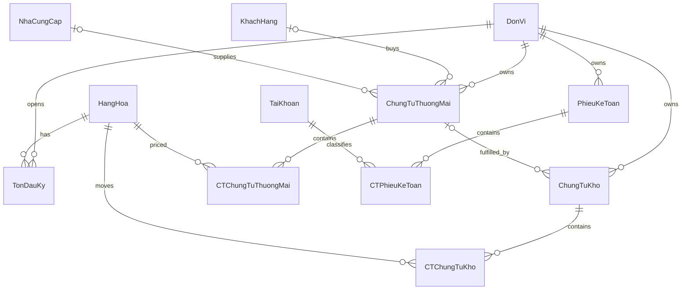

Current state: setup applies migrations through 009-purchase-receipt-invoice-uniqueness.sql (schema version 8). Inventory, commerce, payments, manual ledger, authentication, permissions, unit access and audit schema are implemented. The phase notes below retain the schema history; see ../README.md for current application setup.

# SQL Server schema and synthetic seed

Phase 4 upgrade: setup now also applies `003-inventory.sql` (schema version 2),
adding transactional warehouse posting and report procedures. See
[Phase 4](../docs/PHASE4.md) for the implemented posting safeguards, testing and
retained PN001/PX001 acceptance demo. The Phase 2 notes below describe the original
base schema; posting rules are now implemented through these procedures.

Run from the repository root using the existing `sqlcmd` client. Tested against
local SQL Server Express 16.0.1200.5 (SQL Server 2022), Windows authentication.

```powershell
sqlcmd -S '.\SQLEXPRESS' -E -C -b -l 10 -f 65001 -i database/setup.sql
sqlcmd -S '.\SQLEXPRESS' -E -C -b -l 10 -f 65001 -i database/verify.sql
```

`-C` trusts the local development server certificate; it is not a production TLS
configuration. No passwords or connection credentials are stored. The Web Forms application now uses this database through parameterized ADO.NET.

## Setup and reruns

- `setup.sql` creates only `ReportingModuleDemo` if absent, marks it as this
  project's synthetic demo, and refuses an existing unmarked database.
- `001-schema.sql` applies version 1 once in a transaction under an application
  lock. Future schema changes need a new migration; rerunning version 1 does not
  repair manual schema alterations. No DROP/TRUNCATE/reset is performed.
- `002-seed.sql` inserts the complete seed atomically once, with a seed-history
  marker. Existing reserved IDs cause failure and rollback, not overwrite.
  Subsequent runs preserve user changes. It does not restore deleted seed rows.
- If database creation succeeds but schema application fails, the empty marked
  demo database can remain; rerun setup after correcting the error.
- `verify.sql` checks the pristine demo baseline. It expects HANG001 opening 100;
  intentionally editing that value later makes this baseline check fail.
  Constraint fixtures are rolled back. Identity gaps from tests are normal.

## Schema and relationships



There are 12 business tables plus SchemaVersion and SeedHistory.
Masters are shared; unit belongs to documents and opening stock. A unit is the
inventory partition for this MVP. Multiple warehouses within a unit are not
implemented or represented as invented menu functions.

### Numeric and date conventions

- Quantity: decimal(18,3). Unit price: decimal(19,4).
- Line amount: persisted computed decimal(28,4), rounded to 4 places from
  quantity x unit price. Zero prices are allowed; quantities must be positive.
- Document total is derived as SUM(detail.ThanhTien); no independently editable
  header total is stored. Later services must handle SQL numeric overflow.
- Document dates are `date`. Audit timestamps use UTC `datetime2(0)`.
- TonDauKy is the balance immediately before DonVi.NgayBatDau. The demo starts
  on 2026-01-01. Phase 4 must prevent earlier stock documents and calculate a
  selected period's opening from this baseline plus preceding movements.

### Document conventions for subsequent phases

- Stock types: N (receipt), X (issue). Commercial types: SALES_ORDER,
  SALES_INVOICE, PURCHASE_ORDER, PURCHASE_INVOICE. These are application codes,
  not proprietary FAST syntax.
- Status: DRAFT, POSTED, CANCELLED. New headers default to DRAFT. Draft headers
  may temporarily have no detail; posting must require at least one detail.
- Commercial sales require a customer; purchase documents require a supplier.
  Source-order and commercial-to-stock FKs preserve existence. Services must
  also validate same unit, partner, direction, source type and fulfillment
  quantities before posting. Those semantic checks are not implemented yet.
- Only posted warehouse details will affect physical stock. Commercial invoices
  supply sales/purchase values and future receivable/payable facts. Orders are
  not revenue. Do not count both invoice and warehouse rows as stock movement.
- MaHang may appear on several numbered lines; (header ID, Dong) identifies a
  line. Stock validation must aggregate repeated item lines before checking.
- No cascading deletes: header/detail deletes must be explicit transactions;
  referenced master deletes fail. Header rowversion supports future concurrency.
- Journal detail permits either a positive debit or a positive credit. Whole
  journal balancing, posting and financial statement mapping belong to Phase 7.
  No invented accounts, financial results or tax logic are seeded.
- No payment tables yet. Phase 6 will add the minimum payment/allocation schema
  required by its real semantics, without storing duplicated outstanding totals.

The schema does **not** yet enforce atomic application posting, nonempty posted
documents, balanced journals or nonnegative running stock. Do not treat it as a
completed business backend or allow unvalidated posting from a UI. These require
transactional services/procedures in their respective phases, including a stock
check and write in one concurrency-safe transaction.

## Seed

One clearly labeled demo unit, 10 generic synthetic items, five synthetic
customers and five synthetic suppliers. Tax IDs, addresses and phone numbers are
left null; no company data is fabricated. HANG001 opens at 100, other items at 0.
No receipts, issues, invoices, journal entries or report results are seeded.
Phase 4 acceptance creates PN001 +50 and PX001 -20 through the actual write path,
verifies 130, and rejects issue 200 atomically. The Phase 3–9 regression run and
independent SQL checks pass this acceptance on the local demo database.

## Phase 5 upgrade
setup.sql includes 004-commerce.sql (schema version 3), 008-purchase-workflow.sql (version 7), and 009-purchase-receipt-invoice-uniqueness.sql (version 8). Sales invoices create one linked warehouse issue. Purchase receipts carry supplier and change stock; each receipt can be referenced by at most one purchase invoice, and invoices do not change stock again. Orders do not affect stock. See [Phase 5 defaults](../docs/PHASE5.md). Existing demo stock documents are preserved; legacy combined purchase facts are linked by migration without replaying their stock effect.

## Phase 6 upgrade
setup.sql includes 005-debt.sql (schema version 4). ThanhToanHoaDon stores immutable invoice-level settlements; reports derive partner balances from posted invoices and dated payments. No opening debt or payments are seeded. See [Phase 6 semantics](../docs/PHASE6.md).

## Phase 7 upgrade
setup.sql includes 006-ledger.sql (schema version 5): teaching account mapping, transactional journal procedures and posted-ledger balance report. Six internal account definitions are added without monetary data. Existing definitions are not overwritten. See [Phase 7 semantics](../docs/PHASE7.md).

## Phase 10 upgrade
`setup.sql` includes `007-security.sql` (schema version 6). It creates the application user/role/permission assignments, working-unit assignments and append-only audit log. The migration seeds allowlisted permission codes and the built-in `Administrator`/`User` roles, but creates no user and contains no password. After setup, provision the first Administrator locally with `tools/provision-admin.ps1`. See [Phase 10](../docs/PHASE10.md).

## Purchase workflow upgrade
`setup.sql` also includes `008-purchase-workflow.sql` (schema version 7). Purchase receipts now carry a supplier and affect warehouse stock. Purchase invoices link to a posted receipt from the same unit/supplier and affect payables without creating another stock movement. Existing linked purchase invoice movements are backfilled as legacy references only; no stock entries are replayed. See [Phase 5](../docs/PHASE5.md) for cardinality and reconciliation limits.


